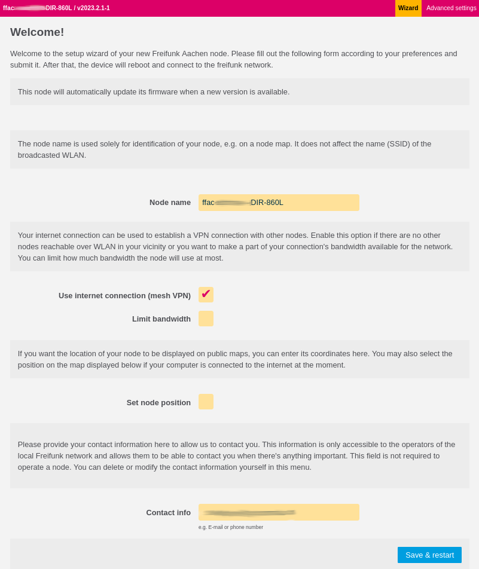

Config Mode
===========

When in Config Mode a node will neither participate in the mesh nor connect
to the VPN using the WAN port. Instead, it'll offer a web interface on the
LAN port to aid configuration of the node.

Whether a node is in Config Mode can be determined by a characteristic
blinking sequence of the SYS LED:

Activating Config Mode
----------------------

Config Mode is automatically entered at the first boot. You can re-enter
Config Mode by pressing and holding the RESET/WPS/DECT button for about three
seconds. The device should reboot (all LEDs will turn off briefly) and
Config Mode will be available.

If you have access to the console of the node, there is the
``gluon-enter-setup-mode`` command, which reboots a node into Config Mode.

Network-Activated Config Mode
-----------------------------

Some models lack a physical button for activating Config Mode. On these
devices, Config Mode can be activated by sending a special packet to the node
while it is booting.

The packet is sent by a Linux utility, which can be built in a Gluon checkout
with a site configuration by running ``make tools``. This creates
``tools/enter-network-config-mode``. Without a site configuration, it can be
built with
``cc -std=c99 -o tools/enter-network-config-mode package/gluon-network-setup-mode/src/send-network-request.c``
after creating the ``tools`` directory.

Alternatively, the packet can be sent by the Python script
``contrib/enter-network-config-mode.py``, which takes the same argument. On
Linux, it only requires Python 3. On other systems, such as macOS or Windows,
it requires `Scapy <https://scapy.net>`_ (``pip install scapy``) and, on
Windows, `Npcap <https://npcap.com>`_.

To enter Config Mode:

1.  Connect your computer directly to the port Config Mode is offered on (see
    `Port Configuration`_ below). Connect it without a switch in between, as
    switches compliant with IEEE 802.1D do not forward the packet.
2.  Start the utility as root with the name of the network interface connected
    to the node as argument, for example
    ``sudo tools/enter-network-config-mode eth0``. It keeps sending the packet
    until it is stopped.
3.  Power-cycle the node. The node listens for the packet for a few seconds
    during boot and enters Config Mode for this boot when receiving it.
4.  Stop the utility.

As some of these devices have no LED indicating Config Mode, check whether
the web interface of Config Mode is reachable at http://192.168.1.1 instead.

The packet is not authenticated: anyone who can send it to the node's Config
Mode port while the node boots can activate Config Mode. On devices with a
single port, this port is also the uplink. Switches compliant with IEEE 802.1D
do not forward the packet, but unmanaged switches may, so the packet may reach
the node from other devices on the same network segment. To prevent the
predictable reboot following an automatic upgrade from being used for this,
the node does not listen for the packet on the first boot after an automatic
upgrade.

This feature is supported on the following devices:

* ZyXEL NWA55AXE

Port Configuration
------------------

In general, Config Mode will be offered on the LAN ports. However, there
are two practical exceptions:

* Devices with just one network port will run Config Mode on that port.
* Devices with PoE on the WAN port will run Config Mode on the WAN port instead.

Accessing Config Mode
---------------------

Config Mode can be accessed at http://192.168.1.1. The node will offer DHCP
to clients. Should this fail, you may assign an IP from 192.168.1.0/24 to
your computer manually.

Advanced Config Options
-----------------------

Depending on the installed packages, the advanced config mode allows to configure packages further.

* :doc:`gluon-web-wifi-config enable <wlan-configuration>` radios used for wifi and mesh as well as outdoor mode
* :doc:`../package/gluon-web-network` allows to configure the used roles (uplink, mesh, client) on each interface
* :doc:`../package/gluon-web-admin` allows to enter SSH keys or set a password in the `Remote access` section
* :doc:`../package/gluon-web-cellular` allows to configure SIM card / WWAN settings on supported cellular devices

The advanced config does also allow to upload a sysupgrade file to update the firmware to a different version.
